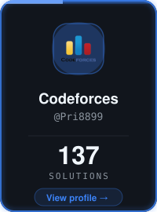
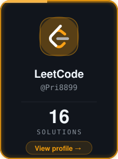
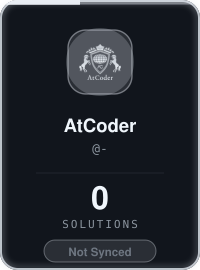
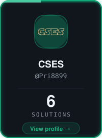
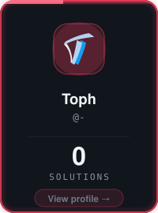

<div align="center">


# Hi there, I'm Partho Paul 👋

**Competitive Programmer &middot; CSE Undergrad @ AUST**

<br/>

[](https://pri8899.github.io/)
[](https://codeforces.com/profile/pri8899)
[](https://leetcode.com/Pri8899)
[](mailto:parthopaul8899@gmail.com)

<br/>

<!-- CodeSync Pro Unified Telemetry Card -->
<a href="https://github.com/Pri8899/CP">
  
</a>

<br/><br/>

<!-- Multi-Platform Solved Overview -->
<a href="https://github.com/Pri8899/CP">
  
</a>

<br/><br/>

<!-- Standardized Glowing Platform Profile Badges -->
<p align="center">
  <a href="https://codeforces.com/profile/Pri8899"></a>
  <a href="https://leetcode.com/Pri8899"></a>
  <a href="https://atcoder.jp"></a>
  <a href="https://cses.fi/problemset"></a>
  <a href="https://toph.co/u/Pri8899"></a>
</p>

</div>

<br/>

```zsh
pri8899@workstation:~$ whoami
{
  "name": "Partho Paul",
  "education": "Undergraduate CSE Student",
  "institution": "Ahsanullah University of Science and Technology",
  "location": "Dhaka, Bangladesh",
  "highlights": [
    "🏆 Codeforces: pri8899",
    "⚡ C++20 & Advanced DSA",
    "💙 Flutter & Android Studio",
    "🎮 Unreal, Roblox & iGraphics"
  ],
  "portfolio": "https://pri8899.github.io"
}
```

### 🛠️ Languages & CS Toolchain

| Category | Technologies |
| :--- | :--- |
| **Languages** |      |
| **Frameworks & Engines** |     |
| **Core Theory & CP** |   |
| **Developer Tools** |      |

### 🚀 Featured Works

- 📦 [**CodeSync-Pro-Extension**](https://github.com/Pri8899/CodeSync-Pro-Extension) — Universal Competitive Programming Workstation & automated GitHub sync engine for Chrome & Edge. Monaco IDE, CPH testcase runner, 1-click submit, and multi-language archiving across Codeforces, AtCoder, CSES, LeetCode & Toph.
- 🤖 [**BigOof**](https://github.com/Pri8899/BigOof) — Feature-packed, open-source Competitive Programming Discord bot. Provides contest countdowns, rating change alerts, server-wide AC feeds, and automated rank roles.
- ⚡ [**CP**](https://github.com/Pri8899/CP) — Systematic algorithmic problem solutions and templates automatically synchronized in real time via CodeSync Pro.

---

<p align="center">
  ⚡ <b>Explore the live interactive macOS-style developer portfolio:</b><br />
  👉 <a href="https://pri8899.github.io/"><b>https://pri8899.github.io/</b></a><br />
  <i>(Featuring Spotlight Search ⌘K, Interactive Terminal, Activity Monitor &amp; 3D Tilt)</i>
</p>
